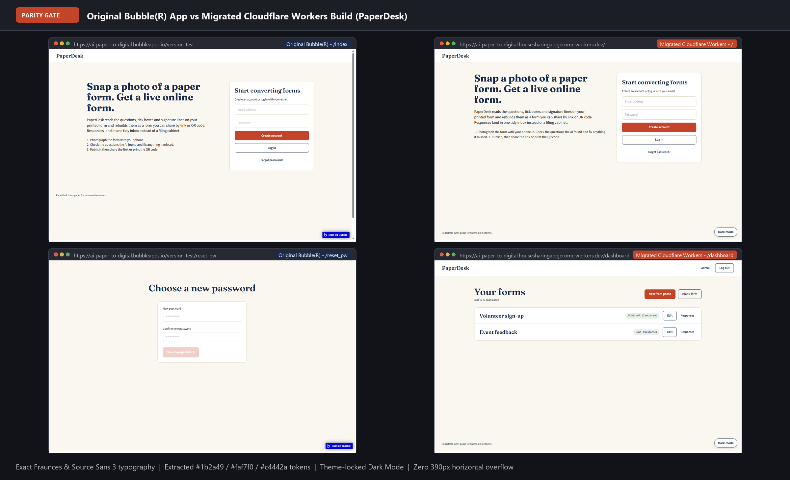

# Bubble to Cloudflare Migrator

[](https://mcpservers.org/servers/red-center-studio/bubble-to-cloudflare-migrator)

Move a Bubble® app's **data, files, backend logic, and frontend UI** into your own Cloudflare account (Workers, D1, and R2), with verification checks at every step. Built by [Red Center Studio](https://redcenterstudio.com).

- **Remote MCP endpoint**: `https://nc.redcenterstudio.com/mcp` (Streamable HTTP)
- **Product page**: https://redcenterstudio.com/products/no-code-migrator/
- **Privacy policy**: https://redcenterstudio.com/privacy/
- **Terms**: https://redcenterstudio.com/terms/
- **Support**: hello@redcenterstudio.com

## Walkthrough & visual parity

> [Watch the 50-second captioned walkthrough video (MP4)](docs/walkthrough.mp4) | [Download VTT captions](docs/walkthrough.vtt)

[](docs/walkthrough.mp4)

Built for **never-worse-than-original** visual and functional parity: exact design tokens (`color_tokens`, `color_tokens_user`, `font_tokens`, `font_tokens_user`), Google Fonts typography, crisp icon mapping, zero 390px horizontal overflow, and theme-locked add-ons (`dark_mode`, `not_found_page`, `theme`, `admin_dashboard`).

## What this plugin does

1. **Data Migrator (Data, Files, Users, Privacy Rules, Redirects)**: Audits your Bubble® schema and records (`nc_audit`, `nc_plan`), creates your D1 database (`nc_schema`), exports records into R2 (`nc_export`), upserts them into D1 (`nc_load`), copies media to R2 by content hash (`nc_files`), prepares passwordless/reset user identities (`nc_users`), compiles privacy rules into default-deny `policy.ts` guards (`nc_access`), maps legacy URLs to 301 redirects (`nc_redirects`), verifies counts/checksums/FKs/files (`nc_verify`), and guides DNS cutover without ever touching DNS (`nc_cutover`).
2. **App Mover (Full Code Rebuild & Deploy)**: Scores a `.bubble` export (`nc_compile_plan`), lets you queue cleanups (`nc_changes`) and modular add-ons (`nc_basket`), builds a **free full-site interactive preview** (up to 80 pages via `nc_preview`, `nc_preview_status`), quotes the full build (`nc_finalise_quote`), and compiles + deploys the full Hono + Drizzle + React Worker into your Cloudflare account (`nc_move`).

## Requirements

- A Bubble® app (Data API access for live record migration; Bubble's **Starter plan or higher** is required by Bubble to export your `.bubble` app JSON from Settings -> General for full UI/workflow scoring and App Mover builds). Both `https://your-app.bubbleapps.io` / custom domains and full Bubble Editor URLs (`https://bubble.io/page?id=your-app...`) work, and `.bubble` exports up to **500 MB** stream directly with secrets stripped in transit.
- A Cloudflare account with API token permissions for D1 and R2 (plus Workers Scripts and Queues for full App Mover deployment). Tokens are typed **only** on the one-time secure page created by `nc_connect`, never in chat.
  1. Open **Cloudflare Dashboard -> R2 Object Storage** (enable R2 if prompted; first 10 GB/month is free).
  2. Click **Create bucket**, enter a lowercase name (letters, digits, hyphens), leave Location **Automatic** and Storage Class **Standard**, and click **Create bucket**.
  3. Return to **R2 Object Storage -> Overview**, click **Manage R2 API Tokens**, then **Create User API token** (or **Create Account API token**).
  4. Select **Object Read & Write** permissions, restrict to **Apply to specific buckets only** for your new bucket, and click **Create API Token**.
  5. Scroll past the `cfat_` Token value to **Use the following credentials for S3 clients** and copy the **Access Key ID** (32 chars) and **Secret Access Key** (64 chars) into the secure `/connect` page.

## Installation & API key setup

All free tools (`nc_ping`, `nc_audit`, `nc_plan`, `nc_connect`, `nc_compile_plan`, `nc_changes`, `nc_basket`, `nc_finalise_quote`, `nc_preview`, `nc_preview_status`, `nc_forget`), the free full-site preview (up to 80 pages), and the 1,000-record data trial work **without an API key**.

### Antigravity

- Install from the Antigravity Marketplace or place this folder in your workspace at `.agents/plugins/bubble-to-cloudflare-migrator` (or globally at `~/.gemini/config/plugins/bubble-to-cloudflare-migrator`).
- `mcp_config.json` connects to `https://nc.redcenterstudio.com/mcp` with no key required for free tools and trials.
- After purchasing a paid pass or credit pack at https://redcenterstudio.com/products/no-code-migrator/, add your `nc_...` API key in `mcp_config.json` (either directly in your local config or as a `variables` prompt, keeping secrets out of committed files):

```json
{
  "mcpServers": {
    "nc-migrator": {
      "url": "https://nc.redcenterstudio.com/mcp",
      "headers": {
        "Authorization": "Bearer ${NC_MIGRATOR_KEY}"
      },
      "variables": [
        {
          "name": "NC_MIGRATOR_KEY",
          "title": "Migrator API key",
          "description": "Your nc_... API key from https://redcenterstudio.com/products/no-code-migrator/",
          "link": "https://redcenterstudio.com/products/no-code-migrator/"
        }
      ]
    }
  }
}
```

### Claude Code

```bash
/plugin marketplace add Red-Center-Studio/claude-plugins
/plugin install nocode-migrator@red-center-studio
```

Or load this standalone plugin directory directly with `claude --plugin-dir ./bubble-to-cloudflare-migrator`, or connect the MCP server directly:

```bash
claude mcp add --transport http nc-migrator https://nc.redcenterstudio.com/mcp
```

Leave the optional `Migrator API key` (`nc_migrator_key`) blank for free discovery, the full-site preview, and the 1,000-record trial.

## Bundled skills

- `audit-bubble`: Read-only inventory, D1 mapping plan, and App Mover score/quote.
- `migrate-data`: Ordered 10-step data, R2 file, user, privacy rule, redirect, verification, and cutover runbook.
- `rebuild-worker`: Automated App Mover workflow (`nc_preview` -> `nc_move`) plus manual Hono + Drizzle Worker guidance from exported artifacts.

## MCP tools (22 total)

| Tool | Tier | Purpose |
|---|---|---|
| `nc_ping` | Free (no key) | Reachability, server version, API key check |
| `nc_account` | Free (no key for pricing) | Pricing, credit balance, active passes, 30-day usage |
| `nc_connect` | Free (no key) | 30-minute one-time secure link for Cloudflare, R2, Bubble tokens, or `.bubble` upload |
| `nc_audit` | Free (no key) | Read-only data type, field, relation, and count audit |
| `nc_plan` | Free (no key) | D1 schema plan, wide-table splits, SQL preview, pass recommendation |
| `nc_compile_plan` | Free (no key) | 0-100 App Mover score, page breakdown, manual item list, tier quote |
| `nc_changes` | Free (no key) | Queue structured schema, privacy, workflow, or page changes |
| `nc_basket` | Free (no key) | Select and price modular add-ons |
| `nc_finalise_quote` | Free (no key) | Compute itemized USD quote before paying |
| `nc_preview` | Free (no key) | Build a free full-site interactive live preview (up to 80 pages) on Cloudflare |
| `nc_preview_status` | Free (no key) | Poll preview build progress and retrieve the signed preview URL |
| `nc_forget` | Free (no key) | Immediately delete uploaded `.bubble` export and temporary build artifacts |
| `nc_schema` | Trial / Pass | Generate D1 SQL migrations + Drizzle schema; optionally apply to D1 |
| `nc_export` | Trial / Pass | Resumable read-only NDJSON record export to R2 (`since` for delta syncs) |
| `nc_load` | Trial / Pass | Idempotent D1 upsert (`truncate_first` requires `confirm_overwrite: true`) |
| `nc_files` | Trial / Pass | Content-hashed R2 file copy, `file_map` tracking, optional text URL rewrite |
| `nc_users` | Trial / Pass | Generate passwordless `magic_link` or `reset_email` identity list (no passwords migrated) |
| `nc_access` | Trial / Pass | Compile privacy rules into default-deny `policy.ts` + tests (`MANUAL` flagged) |
| `nc_redirects` | Trial / Pass | Generate 301 map, `redirects.ts`, `_redirects`, and curl test script |
| `nc_verify` | Trial / Pass | Verify source vs D1 row counts, canonical SHA-256 checksums, FKs, and R2 objects |
| `nc_cutover` | Trial / Pass | Return cutover + delta + rollback checklist; `complete` + `confirm_cutover` purges credentials |
| `nc_move` | App Mover | One-step guided migration, full Worker + React build, verification, and Cloudflare deploy |

## Pricing (USD)

- **Free (no key)**: `nc_ping`, `nc_account`, `nc_connect`, `nc_audit`, `nc_plan`, `nc_compile_plan`, `nc_changes`, `nc_basket`, `nc_finalise_quote`, **full-site live preview (up to 80 pages)** (`nc_preview`), and **1,000-record / 250 MB data trial** (7 days, once per app).
- **Data Migrator passes (30 days per app)**: Starter `$39 USD` (up to 10,000 records, 1 GB files), Migration `$69 USD` (up to 100,000 records, 5 GB files), Large `$199 USD` (up to 500,000 records, 50 GB files).
- **App Mover finalise (includes matching data pass + 2 rebuild rounds + 30-day fix window)**: Small `$129 USD` (up to 10 pages), Standard `$249 USD` (up to 30 pages), Large `$289 USD` (up to 80 pages), Developer mode `$45 USD`, Done-for-you from `$499 USD`. Extra apps finalised within 12 months receive 20% off capped at estimated build cost.
- **Credit packs**: `$25 USD`, `$100 USD` (adds `$110` credits), `$300 USD` (adds `$360` credits). Only built and automatically verified items are charged; failed checks refund automatically.

## Security & privacy

- **Secrets stripped in transit**: `settings.secure` and key-shaped strings inside `.bubble` uploads are removed before storage and never logged.
- **One-time credential pages**: Tokens are encrypted at rest (`AES-GCM`) inside the isolated job object and deleted on `nc_cutover(complete: true, confirm_cutover: true)` or `nc_forget`.

---

Bubble® is a registered trademark of Bubble Group, Inc. Red Center Studio is not affiliated with, endorsed by, or certified by Bubble Group, Inc., Cloudflare, Inc., Anthropic, PBC, or Google LLC.
